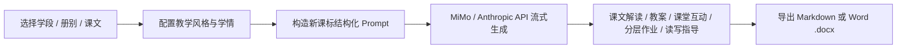

# 📚 语文 AI 教学智能体 (Chinese-Teaching-AI-Agent)

[English](./README_en.md) | 简体中文

[](LICENSE)
[](https://www.python.org/)
[](https://streamlit.io/)
[](https://github.com/forgemorrow/Chinese-Teaching-AI-Agent/actions/workflows/ci.yml)

面向中小学语文教师的大模型智能备课助手，基于 **Streamlit + MiMo（Anthropic SDK 兼容）** 构建，覆盖小初高全学段统编语文教材（3 个学段、24 册教材目录），支持实时流式生成并一键导出 Markdown / Word（`.docx`）教案。

---

## 工作流程



## ✨ 核心功能

| 功能模块 | 说明 |
| :--- | :--- |
| 📖 **课文深度解读** | 结合单元语文要素与新课标要求，梳理文本体裁、重难点与切入点 |
| 📝 **标准教案生成** | 生成包含教学目标、教学过程、核心提问与板书设计的完整教案 |
| 💬 **课堂互动模拟** | 生成课堂导入话术、师生追问链条、学生预设回答与教师点评 |
| 📋 **分层作业设计** | 输出基础巩固、能力提高、拓展探究三层作业设计 |
| ✍️ **读写专项指导** | 提供阅读理解精练、作文审题立意及写作提纲指导 |

## 🎓 教材覆盖范围

- **小学**：一年级上册 ~ 六年级下册（12 册）
- **初中**：七年级上册 ~ 九年级下册（6 册）
- **高中**：高一必修上/下册、高二选择性必修上/中/下册、高三（6 册）

---

## 🚀 快速开始

### 1. 克隆仓库

```bash
git clone https://github.com/forgemorrow/Chinese-Teaching-AI-Agent.git
cd Chinese-Teaching-AI-Agent/语文AI教学智能体
```

### 2. 安装依赖

```bash
pip install -r requirements.txt
```

### 3. 配置 API 并启动

可通过环境变量配置（或启动后在界面侧边栏直接填写）：

```bash
export MIMO_API_KEY="your-api-key"
streamlit run app.py
```

Windows 用户也可直接双击 `语文AI教学智能体/start.bat` 启动，默认访问地址为 `http://localhost:8501`。

---

## 📁 项目结构

```text
Chinese-Teaching-AI-Agent/
├── .github/workflows/ci.yml   # 自动语法与冒烟测试
├── tests/test_smoke.py        # 教材目录、Prompt 与导出冒烟测试
├── 语文AI教学智能体/
│   ├── app.py                 # Streamlit 主应用入口
│   ├── config.py              # 环境变量与模型配置
│   ├── .env.example           # 环境变量配置模板
│   ├── mimo_client.py         # Anthropic SDK 客户端封装（流式输出）
│   ├── prompts.py             # 新课标结构化教学提示词模板
│   ├── export.py              # Markdown 与 Word (.docx) 导出
│   ├── requirements.txt       # 运行依赖
│   ├── start.bat              # Windows 一键启动脚本
│   └── data/textbooks.py      # 统编版小初高 24 册课文目录
├── README.md
├── README_en.md
└── LICENSE
```

---

## 🧪 运行本地测试

```bash
pip install pytest python-docx
pytest tests/ -v
```

---

## 📄 开源协议

本项目基于 [MIT License](LICENSE) 开源。
